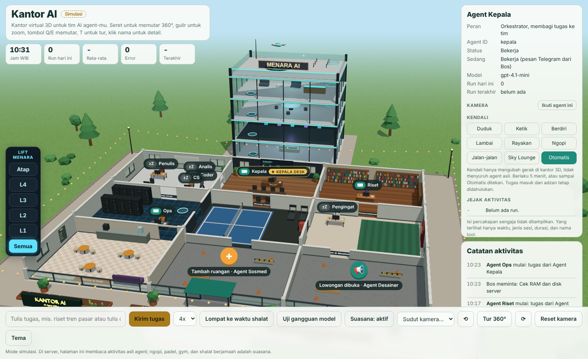

# Kantor AI 🏢🤖

**Kantor virtual 3D untuk tim AI agent-mu.** Lihat agent bekerja seperti manusia: duduk mengetik di meja, mengantar tugas ke rekan, rapat, ngopi di pantry, main padel, naik teleport ke menara futuristik, sampai shalat berjamaah saat adzan.



🔗 **Coba demonya:** [ai-virtuoffice.mshadianto.id](https://ai-virtuoffice.mshadianto.id) · **Kelas & jasa:** [ai-virtuoffice.mshadianto.id/kelas.html](https://ai-virtuoffice.mshadianto.id/kelas.html)

- 🖥️ Satu berkas HTML + three.js, tanpa build step, jalan di browser dan bisa di-install sebagai aplikasi (PWA)
- 🧩 Semua agent, ruangan, dan lowongan diatur dari **satu berkas `agents.json`**
- 📡 **Mode live**: membaca aktivitas asli agent OpenClaw, atau framework apa pun lewat `POST /api/ingest`
- 🔒 **Privasi sejak desain**: isi percakapan agent tidak pernah sampai ke browser
- 🎬 **Mode simulasi**: tanpa server pun kantornya sudah hidup, cocok untuk demo dan konten

## Fitur

| | |
|---|---|
| **Gedung 3D** | Kantor 3×3 ruangan (ruang kerja, ruang kepala, perpustakaan, ruang server, padel & gym, musholla, pantry) dan menara 4 lantai, dimodelkan di Blender |
| **Menara** | L1 lobi & teleport, L2 data center kuantum, L3 ruang strategi hologram, L4 sky lounge, atap dengan drone |
| **Lift Menara** | Potong lantai untuk melihat isi tiap lantai. Badge menunjukkan jumlah agent per lantai |
| **Kamera 360°** | Tujuh sudut siap pakai, tur otomatis, tombol `Q`/`E`/`T` |
| **Ikuti agent** | Kamera menempel pada satu agent, termasuk saat ia naik ke menara |
| **Kendali** | Duduk, ketik, lambai, rayakan, ngopi, jalan-jalan (visual saja, tidak menyuruh agent asli) |
| **Lowongan & rekrutmen** | Papan lowongan, upacara "hari pertama kerja", ruangan baru yang terbangun otomatis |
| **Skalabel** | Agent yang belum terdaftar otomatis mendapat hot desk. Saf shalat bertambah sendiri |
| **Jejak aktivitas** | Riwayat run per agent: waktu, jenis sesi, durasi, dan tool, tanpa isi percakapan |

## Mulai dalam 30 menit

### 1. Lihat demonya (5 menit)
Unduh repo ini, lalu jalankan server statis apa pun dari folder repo:
```bash
python -m http.server 8000      # lalu buka http://localhost:8000
```
Atau aktifkan **GitHub Pages** (Settings → Pages → Deploy from branch → `main` / root), maka kantor Anda online di `https://<username>.github.io/<repo>/`.

### 2. Jadikan kantor Anda (10 menit)
Ubah `agents.json`: nama kantor, nama dan peran agent, warna baju, meja, lowongan. Panduan lengkap ada di [docs/konfigurasi.md](docs/konfigurasi.md).

Papan nama gedung bisa diganti lewat Blender:
```bash
pip install bpy
KANTOR_TITLE="KANTOR XYZ" KANTOR_SUB="Slogan Anda" python blender/build_shell.py -- kantor-shell.glb
```

### 3. Sambungkan agent sungguhan (15 menit)
```bash
AGENTS_DIR=~/.openclaw/agents node server/server.mjs                  # OpenClaw
INGEST_TOKEN=token-panjang-acak node server/server.mjs                # framework lain
```
Detailnya di [docs/integrasi.md](docs/integrasi.md). Selalu pasang di belakang HTTPS dan kata sandi.

## Struktur

```
index.html            aplikasi (three.js via CDN)
agents.json           konfigurasi kantor
kantor-shell.glb      gedung hasil Blender
server/server.mjs     feed live: OpenClaw + /api/ingest, SSE, tanpa dependensi
blender/              skrip bpy pembangun gedung
docs/                 konfigurasi & integrasi
```

## Butuh bantuan?

👉 **[Kelas & jasa Kantor AI](https://ai-virtuoffice.mshadianto.id/kelas.html)**


Repo ini gratis (MIT). Kalau Anda ingin:
- **kantor custom** untuk tim atau perusahaan (logo, ruangan, terhubung ke agent Anda), atau
- **belajar membangunnya** dalam kelas praktik bersama Khadam Digital Academy,

hubungi saya lewat [mshadianto.id](https://mshadianto.id) atau [khadamdigital.mshadianto.id](https://khadamdigital.mshadianto.id).

## Kredit

Dibuat oleh **M. Sopian Hadianto** (Khadam Digital) bersama asisten AI.
Memakai [three.js](https://threejs.org) (MIT), [Blender](https://www.blender.org) untuk model gedung, serta font Bricolage Grotesque & IBM Plex Sans (SIL OFL).
Lisensi: [MIT](LICENSE).
